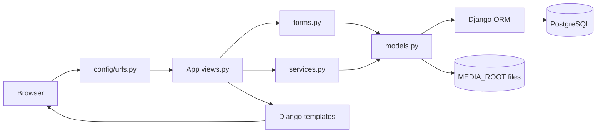
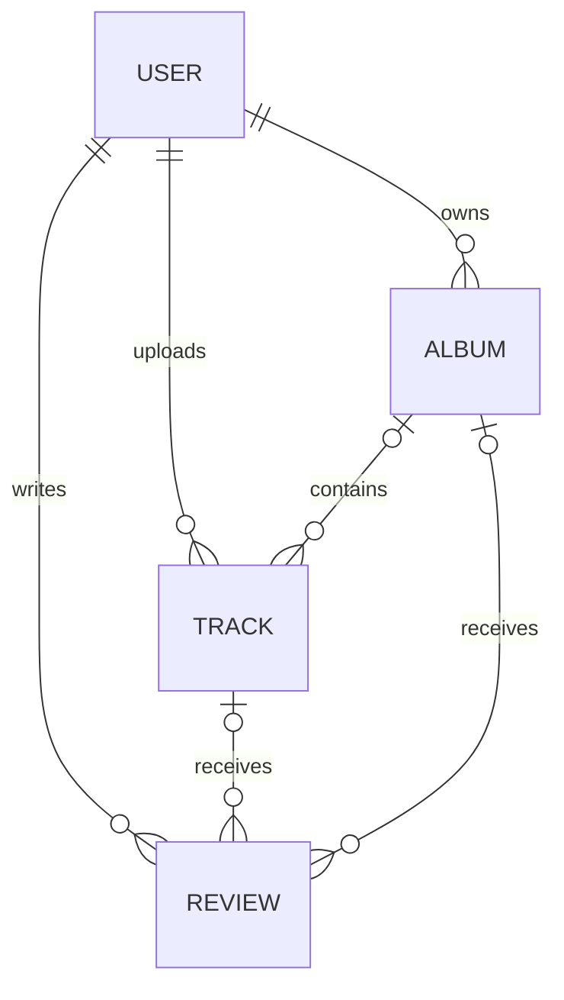

# Project architecture and Django guide

This document describes how the repository works today. It separates implemented
behavior from the larger social network design: several apps are currently only
empty Django shells, while the music app contains the main working feature set.

## 1. Big picture

The project is a server-rendered Django application. A browser requests a URL,
Django calls a view, the view uses a form and/or a service, services use Django's
ORM to read or change PostgreSQL data, and the view renders an HTML template.
The response is HTML; the music player uses the browser's native `<audio>` tag.
There is no REST API, frontend framework, or WebSocket layer in this codebase.



## 2. Repository structure

| Path | Responsibility | Current state |
|---|---|---|
| `config/` | Django settings, root URL configuration, ASGI and WSGI entry points | Configured; root URLs currently include music only |
| `apps/music/` | Albums, tracks, reviews, forms, rules, views and URLs | Main implemented app |
| `apps/core/` | Shared utilities and upload validators | File validators implemented; other modules are empty |
| `apps/accounts/` | Account and profile features | App is registered, but model/view/URL files are empty |
| `apps/feed/` | Posts and feed | App is registered, but model/view/URL files are empty |
| `apps/messaging/` | Messages | App is registered, but model/view/URL files are empty |
| `apps/interactions/` | Social interactions | App is registered, but model/view/URL files are empty |
| `templates/` | Shared layout and app pages | Base layout and music pages exist |
| `static/` | CSS and JavaScript assets | Shared and music styles exist |
| `media/` | Uploaded user files in development | Runtime data; should not be committed |
| `tests/test_music.py` | Music and upload-validator tests | Covers core music behavior |

`INSTALLED_APPS` registers each app, but registration alone does not create its
pages or features. A page becomes reachable only when its URL patterns are
included from `config/urls.py`.

## 3. Django's version of MVC

Django does not enforce a strict MVC naming scheme. The closest mapping here is:

| MVC idea | Django component | In this project |
|---|---|---|
| Model | `models.py`, ORM and database constraints | `Album`, `Track`, `Review` |
| Controller | `urls.py`, `views.py`, `forms.py`, plus service calls | URL dispatch and request handling |
| View | Django templates | `templates/music/*.html` |

The request path is:

1. `config/urls.py` matches the URL and includes `apps.music.urls` under `/music/`.
2. `apps/music/urls.py` chooses a view function.
3. Authentication decorators reject anonymous requests where required.
4. A view reads route parameters and request data, validates a form, and calls a
   service when a business rule or database write is needed.
5. The service uses models and the ORM. Model validation and database constraints
   protect data invariants.
6. The view renders a template or redirects to another named URL.
7. Django returns the response to the browser.

Templates should display data and provide forms/links. They should not decide
permissions or implement business rules. Forms validate request input; services
centralize actions such as ownership checks and review rules.

## 4. Database models and relationships

The configured database engine is PostgreSQL (`django.db.backends.postgresql`).
The music app defines these tables:



- **Album** belongs to a user, has a title, optional image cover and creation time.
- **Track** belongs to a user, may belong to an album, and stores title, artist,
  audio file and upload time. Deleting an album sets a track's album to `NULL`,
  so the track remains in the user's library.
- **Review** belongs to an author and targets exactly one track or album. A check
  constraint enforces the one-target rule. Conditional unique constraints allow
  only one review per author per target. Ratings have validators from 1 to 5.

Foreign keys use `settings.AUTH_USER_MODEL`, so the models do not hard-code the
user table. In the current settings there is no `AUTH_USER_MODEL` override and
`apps/accounts/models.py` is empty. Therefore, Django currently uses its built-in
`auth.User`. The project plan mentions a custom `accounts.User`, but that has not
been implemented here. Changing to a custom user after the first migrations
requires careful migration planning.

### ORM queries used by the music app

The ORM turns Python expressions into SQL. QuerySets are lazy: building a query
does not usually contact the database until the result is evaluated (for example
by iteration, `first()`, `exists()`, or aggregation).

| ORM expression | Meaning in this code |
|---|---|
| `Track.objects.filter(owner=owner)` | Limit tracks to one owner's library |
| `.filter(Q(title__icontains=q) | Q(artist__icontains=q))` | Case-insensitive search across title or artist |
| `.get()` / `get_object_or_404()` | Fetch one row; turn a missing row into HTTP 404 |
| `.select_related("owner", "album")` | Join foreign-key rows in the same SQL query |
| `.select_related("author")` | Fetch review authors with the review query |
| `.order_by(...)` | Set query ordering; model `Meta.ordering` supplies defaults |
| `.first()` | Fetch the first matching row, or `None` |
| `.exists()` | Ask the database whether a row exists without loading all rows |
| `.aggregate(avg=Avg("rating"))` | Calculate a value in SQL, here average rating |
| `.full_clean()` | Run model field, validator and model-level validation in Python |
| `.save()` / `.delete()` | Issue database insert/update or delete operations |

`related_name` creates reverse ORM accessors. For example, `owner.albums.all()`
reads albums owned by a user, `album.tracks.all()` reads an album's tracks, and
`track.reviews.all()` reads its reviews. These are still ORM queries, not separate
copies of related data.

Important distinction: `full_clean()` runs Python validation, but a direct
`.save()` does not call it automatically. The music services explicitly call
`full_clean()` for create/update operations; database constraints remain the
final protection for constraints such as unique reviews and review targets.

## 5. Music request examples

### Uploading a track

1. `POST /music/track/upload/` reaches `track_upload`.
2. `TrackForm` reads text fields from `request.POST` and the uploaded file from
   `request.FILES`. Its album queryset contains only albums owned by the current
   user.
3. Django validates required fields and runs `validate_audio`.
4. `services.create_track()` checks album ownership, constructs the model, calls
   `full_clean()`, and saves the row.
5. Django's `FileField` stores file bytes under `MEDIA_ROOT/tracks/`; the database
   stores a relative file name, not the audio bytes themselves.
6. The view redirects to the track detail page.

### Adding a review

The browser posts to either `/music/track/<id>/review/` or
`/music/album/<id>/review/`. `ReviewForm` converts the rating to an integer and
validates the text length. `services.add_review()` requires exactly one target,
checks for an existing review by that author, validates the model and saves it.
The unique database constraint also protects against duplicate requests racing
each other.

### Editing or deleting

Edit and delete URLs first load the object, then the service verifies that the
requesting user owns it. A violation raises `PermissionDenied` and becomes HTTP
403. Delete endpoints accept POST only, which avoids state changes from a normal
link/GET request. Editing a track may only assign an album belonging to its
owner. Replacing an uploaded file removes the old file after saving its
replacement.

## 6. Forms, validation and uploaded files

- `TrackForm` and `AlbumForm` are `ModelForm`s: Django maps model fields to HTML
  inputs and handles field-level validation.
- `ReviewForm` is a plain `Form` because it collects input that is used to create
  a `Review` through the service layer.
- `apps/core/validators.py` checks filename extensions and maximum file size:
  images allow JPG/JPEG/PNG/WebP up to 5 MB; audio allows MP3/OGG/WAV up to 20 MB;
  message attachments allow those image/audio extensions up to 10 MB.
- These validators check extension and size, not the actual content signature of
  a file. Do not treat a filename extension as proof that a file is safe.
- `MEDIA_ROOT` is the local storage directory and `MEDIA_URL` is its URL prefix.
  `config/urls.py` serves media through Django's helper in development only; a
  production deployment should use a web server or object storage.
- Static CSS/JS live under `static/`; Django serves or collects those separately
  from uploaded media.

## 7. Settings and environment

`config/settings.py` loads `.env` from the repository root using `python-dotenv`.
The database connection uses `DB_NAME`, `DB_USER`, `DB_PASSWORD`, `DB_HOST` and
`DB_PORT`. `SECRET_KEY`, `DEBUG`, allowed hosts, language, timezone, and media
paths are also environment-configurable. `.env.example` is a template; `.env`
contains local secrets and should not be committed.

The current language default is English (`en-us`) and the timezone default is
`Asia/Vladivostok`. Authentication redirects are set through `LOGIN_URL`,
`LOGIN_REDIRECT_URL` and `LOGOUT_REDIRECT_URL`.

## 8. Migrations

Migrations are versioned descriptions of database schema changes. They live in
each app's `migrations/` directory. `0001_initial.py` creates the music tables;
`0002_english_field_labels.py` updates their human-readable field labels. Apply
committed migrations with:

```bash
python manage.py migrate
```

When changing a model, create a migration with `python manage.py makemigrations`
and commit both the model change and resulting migration. Do not edit an already
applied migration to represent a new schema change.

## 9. Routes currently available

The root URL configuration currently includes `/music/` only (apart from the
Django admin). Music routes are:

| URL | Method | Purpose |
|---|---|---|
| `/music/` | GET | Current user's music library and search |
| `/music/u/<username>/` | GET | Another user's library |
| `/music/track/upload/` | GET, POST | Upload a track |
| `/music/track/<id>/` | GET | Track player, navigation and reviews |
| `/music/track/<id>/edit/` | GET, POST | Edit an owned track |
| `/music/track/<id>/delete/` | POST | Delete an owned track |
| `/music/track/<id>/review/` | POST | Review a track |
| `/music/album/new/` | GET, POST | Create an album |
| `/music/album/<id>/` | GET | Album tracks and reviews |
| `/music/album/<id>/edit/` | GET, POST | Edit an owned album |
| `/music/album/<id>/delete/` | POST | Delete an owned album |
| `/music/album/<id>/review/` | POST | Review an album |

The `base.html` navigation contains links to feed, profile, messages and login,
but their apps' URL patterns are not included in the root URL configuration yet.
Those pages are therefore not currently implemented/reachable in this checkout.

## 10. SOLID principles in this code

- **Single Responsibility:** models describe persisted data; forms validate input;
  services hold music rules; views connect HTTP requests to those components;
  templates render HTML.
- **Open/Closed:** new behavior can be added as service functions and routes
  without putting all music logic into one view. Keep constraints close to the
  model so all callers share the same invariants.
- **Liskov Substitution:** the music layer refers to the configured user model
  through `settings.AUTH_USER_MODEL`, rather than assuming a specific user class.
- **Interface Segregation:** forms expose only fields needed for a specific user
  action; service functions receive explicit arguments instead of a whole request.
- **Dependency Inversion:** views depend on the service interface and forms, not
  on raw SQL or storage implementation details. The ORM and Django storage provide
  the lower-level persistence mechanisms.

These are useful design goals rather than a claim that every part is complete.
For example, the other registered apps still need their models, services, views,
templates, routes and tests before the larger social-network design is present.

## 11. Useful commands

```bash
# Apply database schema
python manage.py migrate

# Create an admin account
python manage.py createsuperuser

# Start the development server
python manage.py runserver

# Run the music test suite
python manage.py test tests.test_music
```

The test command is documented for developers; it has not been run as part of
writing this document.
